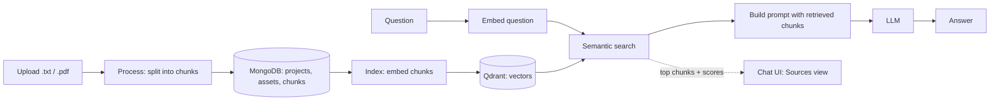
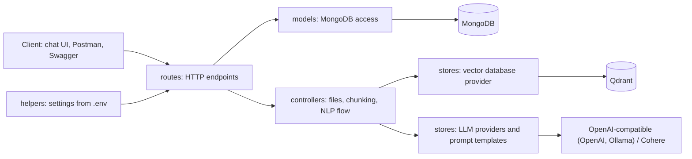

# RAG Document Assistant(Mini RAG)

A retrieval-augmented question answering API built with FastAPI. Upload a `.txt` or `.pdf` file, split it into chunks, index the chunks in a vector database, then ask questions and get answers based on the retrieved text. Tested with **Arabic and English** documents.


## Features

- Accepts `.txt` and `.pdf` uploads (PDF text is read with PyMuPDF) and splits them into overlapping chunks (size and overlap are set per request).
- Stores projects, uploaded files (assets) and chunks in MongoDB.
- Embeds chunks with Cohere multilingual embeddings and stores the vectors in Qdrant (embedded, saved to a local folder).
- Finds relevant chunks with semantic search (cosine similarity), builds a prompt from them and asks an LLM for the answer.
- Includes a browser chat UI that shows each answer with the top-ranked chunks and their similarity scores (fetched with a separate search call).

## How it works



Providers are chosen with `GENERATION_BACKEND` and `EMBEDDING_BACKEND` in `.env`.

## Code structure



The repo also contains `docker/` (MongoDB service), `postman/` (request collection), `ui/` (chat page), `samples/` (test documents) and `docs/` (demo GIF and screenshots).

## Tech stack

| Part | Technology |
|---|---|
| API | FastAPI, Uvicorn |
| Database | MongoDB (Motor), run with Docker |
| Vector database | Qdrant (embedded) |
| Embeddings | Cohere `embed-multilingual-light-v3.0` |
| Generation | OpenAI provider (works with the OpenAI API and any OpenAI-compatible server, such as Ollama), and a Cohere provider. The demo used the OpenAI provider with `gemma2:9b-instruct-q5_0` on Ollama, served from Google Colab through ngrok. |
| Testing | Postman collection, Swagger UI at `/docs` |

## Screenshots

| Upload | Process |
|---|---|
|  |  |

| Index | Search |
|---|---|
|  |  |

| Answer | API endpoints |
|---|---|
|  |  |

## Quick start

### Requirements

- Python 3.11, Docker, and a Cohere API key (used for embeddings)
- For generation: an OpenAI API key, or a Google account (Colab) and an ngrok account to run Ollama
- Packages are listed in `src/Requirements.txt` (FastAPI, Uvicorn, Motor, qdrant-client, Cohere, the OpenAI client, PyMuPDF, LangChain). `httpx` is pinned to 0.27.2 to avoid a `proxies` error.

### 1. Install

```bash
conda create -n mini-rag-app python=3.11
conda activate mini-rag-app
pip install -r src/Requirements.txt
```

### 2. Configure

```bash
cp src/.env.example src/.env
```

Fill in `src/.env`, starting with `COHERE_API_KEY`. Never commit `.env`.

### 3. Start MongoDB

```bash
cd docker
cp .env.example .env     # edit with your credentials
docker compose up -d
```

`MONGODB_URI` in `src/.env` must match this container's user, password and port (the example file uses `admin:admin` on port `27007`).

### 4. Generation model

**Option A: OpenAI.** In `src/.env`, set `GENERATION_BACKEND="OPENAI"`, `OPENAI_API_KEY` and `GENERATION_MODEL_ID` to a valid model name.

**Option B: Ollama on Colab (used in the demo).**

1. Open the [Colab notebook](https://colab.research.google.com/drive/1d2AVx7rBh0U3UnDTQjLaW-62y1iuvIkb?usp=sharing) and choose **File, Save a copy in Drive**.
2. Add your ngrok auth token to Colab **Secrets** under the name `NGROK`.
3. Run the cells until the one that prints the public ngrok URL. The notebook serves `gemma2:9b-instruct-q5_0`.
4. In `src/.env`, set `GENERATION_BACKEND="OPENAI"`, `GENERATION_MODEL_ID="gemma2:9b-instruct-q5_0"` and `OPENAI_API_URL` to the ngrok URL.

Update `OPENAI_API_URL` whenever the notebook prints a new URL.

### 5. Run the server

```bash
cd src
uvicorn main:app --reload --host 0.0.0.0 --port 5000
```

Open `http://localhost:5000/docs`. Restart the server after editing `.env`.

### 6. Chat UI

Open `ui/mini-rag-ui.html` and set the API address to `http://localhost:5000` (the page defaults to port 8000). Upload `samples/english_test.txt` or `samples/arabic_test.txt`, click **Process files**, then **Index chunks**, then ask a question. Open **Sources** under an answer to see the retrieved chunks and scores.

The server allows all origins (CORS) so the page can call it. Restrict `allow_origins` in `src/main.py` before deploying.

## API

All routes are under `/api/v1`. `project_id` is a string; the project is created on first use.

| Method | Route | Body | Purpose |
|---|---|---|---|
| GET | `/` | none | Welcome and version |
| POST | `/data/upload/{project_id}` | multipart `file` | Upload a document |
| POST | `/data/process/{project_id}` | `chunk_size`, `overlap_size`, `do_reset` | Split files into chunks |
| POST | `/nlp/index/push/{project_id}` | `do_reset` | Embed chunks and store the vectors |
| GET | `/nlp/index/info/{project_id}` | none | Vector collection info |
| POST | `/nlp/index/search/{project_id}` | `text`, `limit` | Semantic search |
| POST | `/nlp/index/answer/{project_id}` | `text`, `limit` | RAG answer |

A Postman collection for every route is in `postman/`.

## Limitations

- **The number of retrieved chunks changes the answer.** For an Arabic question about Cairo with 3 chunks, one run answered from a chunk about Arabic dialects although the Cairo chunk ranked first (similarity 0.584 against 0.396 and 0.368). Other 3-chunk runs of the same question answered about Cairo. With 1 chunk, the English question about the pyramid's height was answered in Arabic as "not in the document" (three runs); with 3 chunks it was answered correctly in English.
- **Some answers began with a `##` header line copied from the prompt.** The UI removes header lines when displaying an answer; the API response is unchanged.
- **Input text is truncated before embedding** to `INPUT_DAFAULT_MAX_CHARACTERS` (1024 in `.env.example`), so chunk sizes above that lose text.
- **Only `.txt` was used in the demo.** PDF loading is implemented but was not part of the test runs. Uploading the same file twice stores two copies, and both are processed.

## Credits

Built while following the **mini-RAG: From notebooks to the PRODUCTION** course by [Abu Bakr Soliman](https://www.youtube.com/@bakrianoo) ([playlist](https://www.youtube.com/playlist?list=PLvLvlVqNQGHCUR2p0b8a0QpVjDUg50wQj)). The original code is at [bakrianoo/mini-rag](https://github.com/bakrianoo/mini-rag).

## License

See [LICENSE](LICENSE).
